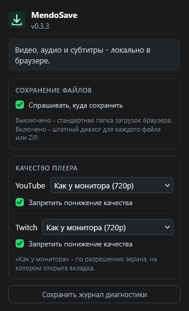
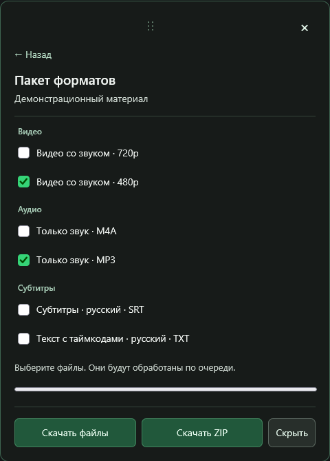

<div align="center">
  
  <h1>MendoSave</h1>
  <p><b>Видео, аудио и субтитры - прямо из браузера.</b></p>
  <p>
    <a href="https://github.com/mendozie/MendoSave/releases"></a>
    <a href="https://github.com/mendozie/MendoSave/actions/workflows/verify.yml"></a>
    <a href="LICENSE"></a>
  </p>
  <p><a href="#установка">Установка</a> · <a href="docs/SITE_MATRIX.md">Проверенные площадки</a> · <a href="CHANGELOG.md">Что нового</a> · <a href="PRIVACY.md">Приватность</a></p>
</div>

MendoSave сохраняет выбранное медиа и обрабатывает его внутри расширения. Основная среда - **Zen на Windows**; сборка для Chromium использует общий код. Библиотеки входят в пакет, отдельная программа обработки не нужна. Сеть используется для получения материала с площадки и её CDN.

## Возможности

- Видео с выбором доступного качества, исходных кодеков или MP4 с H.264/AAC.
- Аудио, включая преобразование в MP3.
- SRT, обычный TXT и TXT с реальными таймкодами; главы YouTube добавляются, когда их принадлежность материалу подтверждена.
- Несколько форматов одного материала: последовательное сохранение отдельных файлов или локальный ZIP.
- Штатный **Save As**, прогресс, отмена и ручное восстановление подготовленных файлов.

Варианты зависят от площадки и материала. DRM и недоступные пользователю форматы не обходятся. Пакет форматов не является загрузкой целого плейлиста.

<table>
  <tr>
    <td valign="top"></td>
    <td valign="top"></td>
  </tr>
</table>

Скриншоты 0.3.3 сняты в отдельном профиле Zen. Справа - реальный компонент окна пакета с нейтральными демонстрационными данными; это иллюстрация интерфейса, а не проверка конкретного сайта.

## Установка

Готовые файлы и контрольные суммы находятся в [Releases](https://github.com/mendozie/MendoSave/releases). Версия **0.3.3 готовится к выпуску**; подписание и публикация фиксируются в [roadmap](docs/ROADMAP.md). Последняя опубликованная версия - 0.3.1. Промежуточная отправка 0.3.2 заменена после PR review.

| Браузер | Файл | Как установить |
|---|---|---|
| Zen / Firefox | `mendosave-<version>-firefox-signed.xpi` | `about:addons` → шестерёнка → «Установить дополнение из файла…» |
| Chrome / Chromium / Edge | `mendosave-<version>-chromium-unsigned.zip` | Распаковать в постоянную папку; `chrome://extensions` / `edge://extensions` → режим разработчика → «Загрузить распакованное расширение» |

Для Firefox-сборки нужен **Gecko 157.0+**. Подписанный unlisted XPI устанавливается постоянно; страницы в AMO и собственного сервера обновлений нет. Chromium ZIP предназначен для распакованной установки, публикация в Chrome Web Store не выполняется. Обновления устанавливаются вручную. Сверяй SHA-256 с `SIGNED_SHA256SUMS` того же выпуска.

Фактические браузерные проверки: Zen 1.23.2b / Gecko 157.0.1, Edge 155.0.4283.45 и прежний Chromium 148.0.7778.96 на Windows. Эти результаты не подтверждают все производные браузеры, Firefox-версии и другие ОС. [Полная инструкция и обновление](docs/INSTALLATION.md).

## Сохранить файл или пакет

Открой меню MendoSave в плеере и выбери один формат. Для пакета нажми **«Выбрать несколько…»**, отметь позиции и выбери **«Скачать файлы»** или **«Скачать ZIP»**.

Окно пакета можно перетаскивать за шапку; оно остаётся в пределах окна браузера. **«Скрыть»** и Escape сохраняют выбор и работу очереди, нижняя кнопка открывает тот же пакет. **Крестик** полностью убирает окно и нижнюю кнопку; во время скачивания и очистки после отмены он недоступен. **«Отменить пакет»** останавливает текущую и оставшиеся позиции, после завершения очистки можно запустить пакет снова.

Для выбора имени и папки открой popup расширения и включи **«Спрашивать, куда сохранить»** в разделе **«Сохранение файлов»**. По умолчанию используется папка загрузок браузера. Отдельные файлы вызывают отдельные диалоги; один ZIP - один диалог.

Уже сохранённые файлы остаются на диске после ошибки или отмены. Подготовленные входы отменённого ZIP можно выгрузить через восстановление в popup. OPFS является временным хранилищем; автоматического продолжения незавершённого задания после закрытия браузера нет. Текущие пределы пакета - 20 позиций и 1 GiB на ZIP; измеренные границы для каждого браузера описаны в [проверках](docs/SITE_MATRIX.md).

## Разработка

Нужен **Node.js `^22.13.0 || >=24`**. Из корня проекта:

```sh
npm ci --ignore-scripts
npm run verify
```

В PowerShell используй `npm.cmd`, если политика блокирует shim. Pipeline запускает tests, lint, dependency audit, проверки manifests/CSP/состава сборок и исходящих файлов, затем готовит неподписанные архивы. Выходы - `dist/firefox` и `dist/chromium`; не загружай исходный `extension/manifest.json`.

В отдельном тестовом профиле Zen: `about:debugging` → **This Firefox** → **Load Temporary Add-on** → `dist/firefox/manifest.json`. Временная установка исчезает после полного перезапуска. Настройки проверки подписей менять не требуется. Chromium загружается распакованным из `dist/chromium`.

[Сборка и QA](docs/DEVELOPMENT.md) · [Зависимости и известные lint/audit warnings](docs/DEPENDENCIES.md) · [Требования](docs/PROJECT_SPEC.md) · [Roadmap](docs/ROADMAP.md)

## Приватность и безопасность

Медиа обрабатывается локально. Расширение не содержит аналитики, рекламы или Native Messaging и не отправляет медиа/журналы разработчику автоматически. Настройки и временные файлы остаются в хранилище расширения; скачанные файлы - в выбранной папке.

Диагностический журнал можно экспортировать вручную. При ошибке расширение также может сохранить локальный `MendoSave-debug.txt`. Код ограничивает данные и скрывает известные credentials, пути и части ссылок; перед внешней передачей проверь файл на личные сведения. [PRIVACY.md](PRIVACY.md) · [Сообщить о проблеме безопасности](SECURITY.md).

## Лицензия и происхождение

MendoSave развивается на основе **Nova Video Saver** и распространяется под [GPL-3.0-only](LICENSE). Исторический README и закреплённый исходник описаны в [SOURCE_AUDIT.md](docs/SOURCE_AUDIT.md). Авторство и условия FFmpeg, ffmpeg.wasm, Mediabunny и zip.js сохранены в [THIRD_PARTY_NOTICES.md](THIRD_PARTY_NOTICES.md) и входят в обе сборки.
