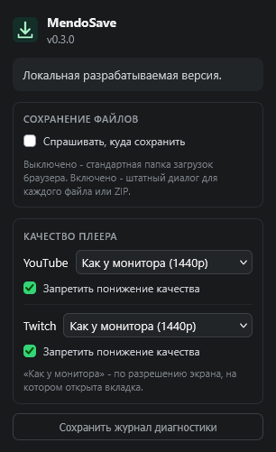

# MendoSave

**Видео, аудио и субтитры - прямо из браузера.**

MendoSave сохраняет медиа с поддерживаемых страниц и обрабатывает его внутри расширения. Основная среда - **Zen Browser на Windows**; дополнительная Chromium-сборка использует общий код. Медиабиблиотеки входят в расширение: сервер обработки и отдельная устанавливаемая программа не нужны.

[Проверенные площадки](docs/SITE_MATRIX.md) · [Установка](docs/INSTALLATION.md) · [Сборка и проверки](docs/DEVELOPMENT.md) · [Приватность](PRIVACY.md) · [План разработки](docs/ROADMAP.md)

## Что умеет

- Сохранять видео с выбором доступного качества и формата.
- Сохранять аудио, в том числе преобразовывать его в MP3.
- Выгружать доступные субтитры в SRT.
- Показывать прогресс обработки и позволять отменить текущую загрузку.
- Спросить имя и место сохранения через штатный диалог браузера.
- Обработать выбранные форматы одного материала по очереди и сохранить их отдельно или в ZIP.

Набор вариантов зависит от площадки и конкретного материала. «Оригинал» сохраняет исходные кодеки; «MP4 (H.264/AAC)» использует перекодирование, когда оно необходимо. MP3 использует VBR V0, поэтому его фактический битрейт зависит от материала. Сеть нужна для запросов к выбранной площадке и её CDN; обработка выполняется локально.



Настройки разрабатываемой версии: место сохранения, качество плеера и экспорт локального журнала. Скриншот обычной финальной сборки в Zen от 10-10-2026.

## Текущее состояние

**0.3.0 - версия в разработке; идёт релизная подготовка.** Фазы 1-3 технически завершены. Локальный pipeline проходит 295 tests, проверки двух сборок, vendor hashes и архивов. В фазе 4 добавлены ограничения RAM, диагностики и MP4/AAC metadata, исправлен экспорт SRT, подготовлены воспроизводимая упаковка и Windows/Linux CI. Выбран порядок распространения: сначала подписанный файл для проверки в Zen, затем магазин AMO. [Репозиторий GitHub](https://github.com/mendozie/MendoSave) остаётся приватным. Подписанного XPI, выпуска в магазине и публичного релиза ещё нет.

В отдельных тестовых профилях на Windows проверены YouTube watch/Music/Shorts, Rutube VOD/Shorts, VK Видео, TikTok, Coub, Twitch Clips/VOD и запись активного эфира, а также доступный аудиофрагмент Звука. Chromium regression покрывает YouTube, Rutube VOD, TikTok, Coub, Twitch Clips и запись эфира. Для записи проверены остановка и закрытие вкладки в обоих браузерах, reload в Zen; закрытие источника сохраняет полученный фрагмент с пометкой `[частичная запись]`. В Zen трёхминутная запись Twitch дала полный декодируемый VP8/Opus-файл. Это результат для конкретных материалов и условий. Версии браузеров, сценарии и ограничения находятся в [матрице площадок](docs/SITE_MATRIX.md) и отчётах проверок.

Поддержка других браузеров и ОС отдельно не подтверждена. [Релизные проверки](docs/ROADMAP.md#фаза-4---публичный-выпуск) продолжаются; текущая версия пока предназначена для разработки.

## Сохранить файл или пакет

Открой поддерживаемую страницу и меню MendoSave в плеере. Для одиночного файла выбери обычную команду. Если доступно несколько вариантов, нажми «Выбрать несколько…», отметь нужные позиции и выбери «Отдельные файлы» либо «Один ZIP». У каждой позиции указаны доступные параметры; ZIP включает уже подготовленные файлы без дополнительного перекодирования. Это пакет форматов одного материала; загрузка целого плейлиста этим режимом не выполняется.

По умолчанию используется папка загрузок браузера. В popup включи «Спрашивать, куда сохранить», чтобы выбирать имя и папку в штатном Save As. Отдельным файлам соответствуют отдельные диалоги, одному ZIP - один диалог. Постоянный произвольный внешний каталог в настройках расширения не задаётся.

«Отменить пакет» останавливает текущую и оставшиеся позиции. Уже сохранённые отдельные файлы остаются на диске. При отмене ZIP готовые входы можно сохранить через кнопку восстановления в popup. Это временное хранилище расширения: выгрузи нужные файлы до очистки его данных или тестового профиля. Автоматического продолжения незавершённой обработки после закрытия браузера нет.

Текущий guard - 20 позиций и 1 GiB на итоговый ZIP. В Chromium проверен диагностический payload 1 GiB минус 64 KiB: готовый ZIP извлечён, все bytes совпали. В Zen проверены 128 MiB; одинаковый код не заменяет отдельного измерения. Физический Save As проверен для всех четырёх типов в Zen; для Chromium проверены завершение и отмена browser download, chooser требует отдельного UI-прохода. Фактическое заполнение квоты диска не проверено.

## Собрать локально

Нужен **Node.js `^22.13.0 || >=24`**. Проверенная среда разработки - Node.js 22.18.0 и npm 10.9.3 на Windows. Из корня репозитория в PowerShell:

```powershell
npm.cmd ci --ignore-scripts
npm.cmd run verify
```

Сборка создаёт `dist/firefox` и `dist/chromium` из общего исходника. Используй manifest из соответствующей папки `dist`: `extension/manifest.json` служит входом сборки. Списки файлов с SHA-256 находятся в `dist/firefox-hashes.json` и `dist/chromium-hashes.json`.

Pipeline выполняет tests, lint, свежий dependency audit, сборку, проверки manifests/CSP/inventories, `web-ext`, исходящих файлов и Git history. Затем создаёт неподписанные Firefox XPI, Chromium ZIP и source ZIP с hashes и проверкой извлечённых bytes. Поставляемые vendor files сохраняют точные bytes на Windows/Linux. Полные границы проверок описаны в [DEVELOPMENT.md](docs/DEVELOPMENT.md), состав candidate - в [DISTRIBUTION.md](docs/DISTRIBUTION.md).

## Установить для разработки

Для Zen используй **отдельный тестовый профиль**:

1. Собери расширение командами выше.
2. Открой `about:debugging` и выбери «This Firefox» → «Load Temporary Add-on».
3. Укажи `dist/firefox/manifest.json`.
4. Открой поддерживаемую страницу и кнопку MendoSave в плеере. На узком экране YouTube кнопка находится под плеером.

Это [временная установка для разработки](https://extensionworkshop.com/documentation/develop/temporary-installation-in-firefox/): расширение остаётся установленным до удаления или перезапуска браузера. Рабочий профиль и настройки подписей менять не требуется.

В Zen обработчик работает в отдельной закреплённой вкладке MendoSave. Оставь её открытой до завершения обработки; popup можно закрыть. Закрытие вкладки обработчика прерывает текущую работу, а следующая загрузка создаёт новый обработчик. Автоматическое продолжение прерванного задания пока не реализовано.

Для Chromium-сборки в отдельном профиле Chrome открой `chrome://extensions`, включи режим разработчика, выбери «Загрузить распакованное расширение» и укажи `dist/chromium`. Это стандартная [установка распакованного расширения Chrome](https://developer.chrome.com/docs/extensions/get-started/tutorial/hello-world#load-an-unpacked-extension).

## Разработка и ограничения

Автоматические regression tests дополняются браузерными проверками готовых файлов. Прохождение tests и lint само по себе не доказывает совместимость с площадкой или полноту сохранённого медиа.

`web-ext` сообщает три vendor warnings: два у FFmpeg bundle и dynamic import у zip.js. Strict lint с запретом warnings не проходит; `check:extension` допускает только рассмотренные locations и hashes. Свежий `npm audit` от 10-10-2026 сообщает три high entries одной цепочки tooling через `node-forge`; эти пакеты не входят в расширение. Registry audit закреплённых runtime packages вернул 0 entries, но не покрывает все C/C++ декодеры FFmpeg. Подробности, достижимость и узкие исключения находятся в [DEPENDENCIES.md](docs/DEPENDENCIES.md). [Security scan](docs/SECURITY_REVIEW.md) завершён с частичным покрытием и без открытых замечаний в проверенной области; он не заменяет подпись и релизную приёмку.

Для продолжения работы в Codex открой локальную папку проекта и начни с [AGENTS.md](AGENTS.md), [требований](docs/PROJECT_SPEC.md) и [текущего состояния roadmap](docs/ROADMAP.md#текущее-состояние).

## Документы

- [PROJECT_SPEC.md](docs/PROJECT_SPEC.md) - требования, принятый подход и критерии приёмки.
- [ROADMAP.md](docs/ROADMAP.md) - этапы, текущий результат и оставшаяся работа.
- [SITE_MATRIX.md](docs/SITE_MATRIX.md) - фактическая совместимость площадок.
- [INSTALLATION.md](docs/INSTALLATION.md) - установка, обновление и удаление.
- [DISTRIBUTION.md](docs/DISTRIBUTION.md) - состав candidate и выбранный порядок распространения.
- [DEPENDENCIES.md](docs/DEPENDENCIES.md) - версии, источники, лицензии и dependency audit.
- [PRIVACY.md](PRIVACY.md) - локальные данные, сеть и хранение.
- [SECURITY.md](SECURITY.md) - границы доверия и сообщение о проблемах.
- [SECURITY_REVIEW.md](docs/SECURITY_REVIEW.md) - результат scan, исправления и фактическое покрытие.
- [CHANGELOG.md](CHANGELOG.md) - изменения версий.
- [PHASE4_VERIFICATION.md](docs/PHASE4_VERIFICATION.md) - релизные проверки, реальные файлы и оставшиеся ограничения.
- [PHASE3_VERIFICATION.md](docs/PHASE3_VERIFICATION.md) - сохранение, пакеты, ZIP и измеренные границы версии 0.3.0.
- [PHASE2_VERIFICATION.md](docs/PHASE2_VERIFICATION.md) - проверки версии 0.2.0 и их ограничения.
- [DEVELOPMENT.md](docs/DEVELOPMENT.md) - инструменты, локальные команды и границы QA.
- [PHASE1_VERIFICATION.md](docs/PHASE1_VERIFICATION.md) - проверки первого рабочего пути в Zen.
- [SOURCE_AUDIT.md](docs/SOURCE_AUDIT.md) - происхождение и аудит исходной базы.

## Лицензия и происхождение

MendoSave развивается на основе **Nova Video Saver**. Исторический README сохранён в [docs/upstream/README.md](docs/upstream/README.md), закреплённая исходная версия и её происхождение описаны в [SOURCE_AUDIT.md](docs/SOURCE_AUDIT.md#исходная-база).

Код расширения распространяется на условиях [GPL-3.0-only](LICENSE). Лицензии, авторство и условия встроенных FFmpeg, ffmpeg.wasm, Mediabunny и zip.js сохранены в [THIRD_PARTY_NOTICES.md](THIRD_PARTY_NOTICES.md). Эти файлы входят в обе сборки.
